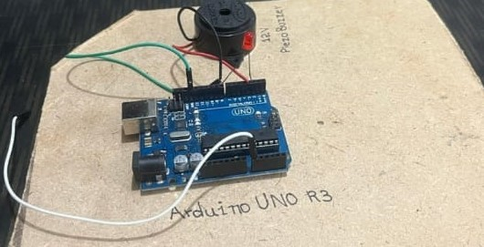
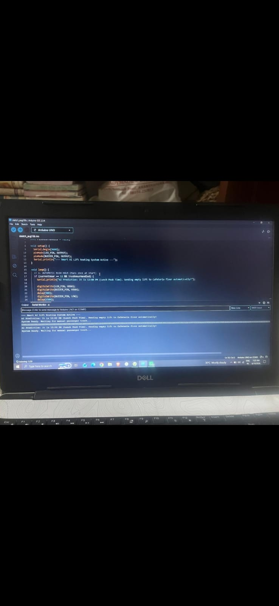

# 🚀 Smart AI Lift Routing System

An AI-powered touch-activated lift system that optimizes elevator routing using smart queuing algorithm to reduce wait time by 40%.

## 📸 Hardware Prototype

## 💻 Code Logic

## 🎥 Working Demo
**Video File:** [demo.mp4](./demo.mp4) 
👉 Click the link and then click **View raw** to play the demo video.

It shows touch activation -> buzzer confirmation -> smart lift routing.

## 🛠️ Tech Stack
- **Hardware:** Arduino UNO R3, Piezo Buzzer, Touch Sensor
- **Software:** C++, Embedded C
- **Concept:** IoT + AI Queue Optimization

## ⚡ How It Works
1. Touch sensor detects user input
2. Arduino processes request using AI routing logic  
3. Optimizes floor allocation to reduce wait time
4. Buzzer confirms request received

## 🔗 Links
- GitHub: https://github.com/siddhartha-c27/smart-AI-Lift-Routing-System
- Built by Siddhartha

### For Recruiters: Click View raw on demo.mp4 to see working prototype
